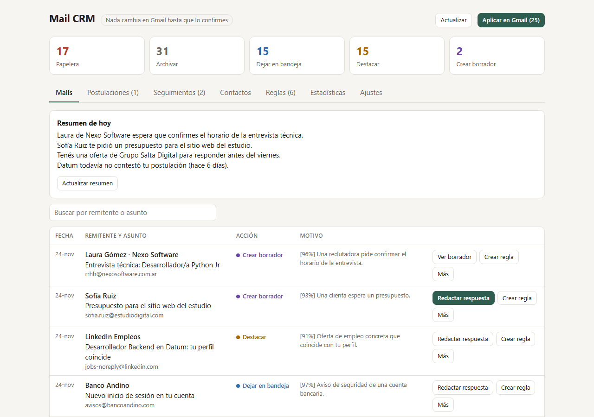
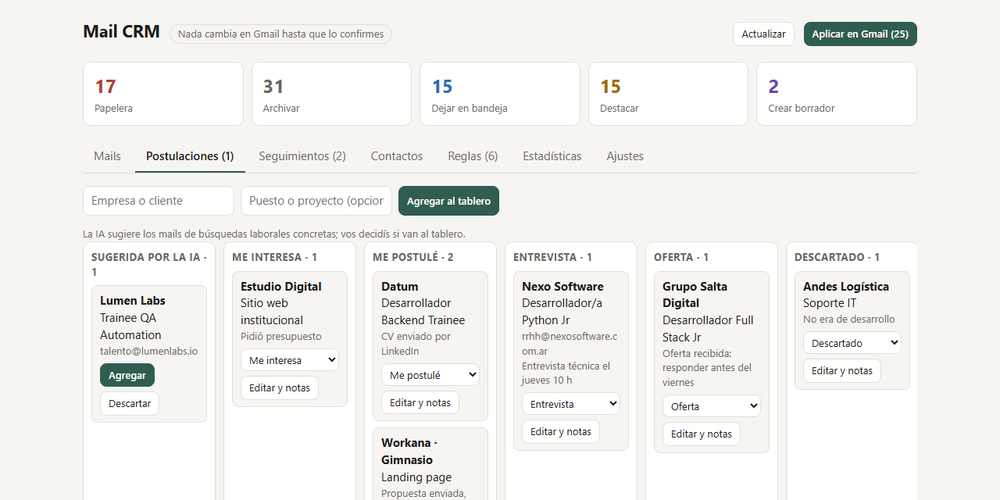
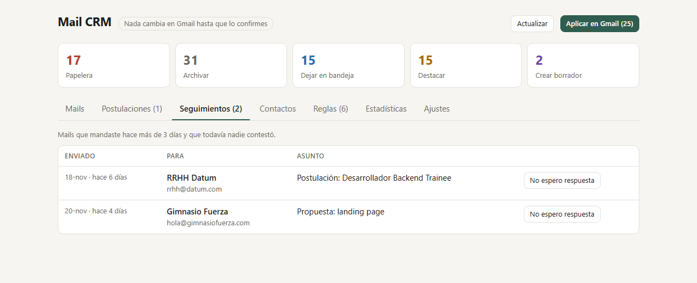
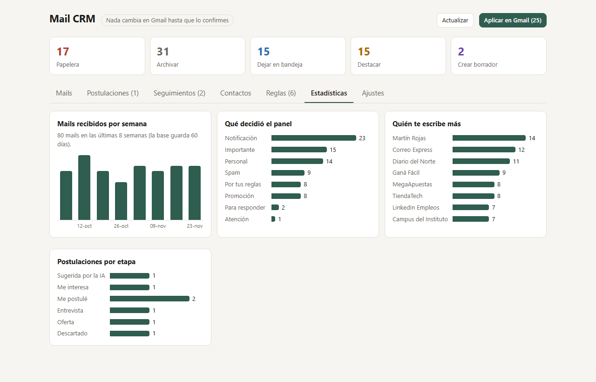
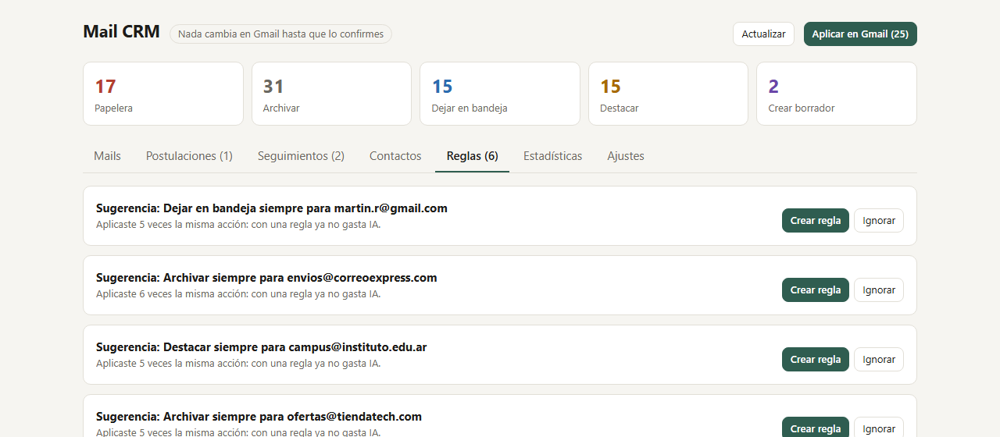
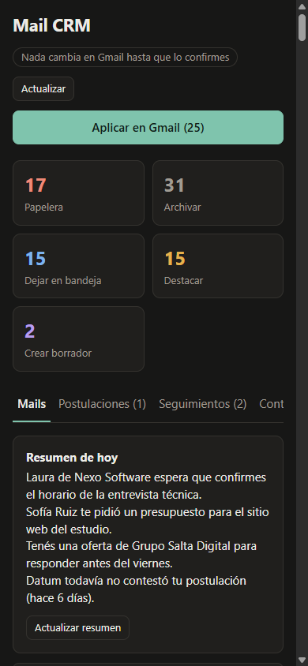
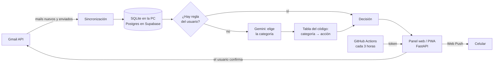

# Mail CRM

Un CRM personal que lee mi Gmail, ordena el correo con reglas e inteligencia artificial y me ayuda con la búsqueda laboral: detecta ofertas, lleva un tablero de postulaciones, avisa qué mails quedaron sin respuesta y arma un resumen cada mañana. Funciona como app instalable (PWA) en la PC y en el celular.

La regla de diseño principal es que **la IA propone y yo decido**: nada cambia en Gmail sin mi confirmación (salvo mis propias reglas, si las activo), todo se puede deshacer y la app no tiene forma de enviar un mail.



> Las capturas usan datos inventados.

## Qué hace

- **Clasifica el correo con IA (Gemini):** spam, promoción, notificación, atención, personal, importante o "para responder". La IA solo elige la categoría; qué se hace con cada una lo decide una tabla del código.
- **Aplica acciones en Gmail** (papelera, archivar, destacar) después de confirmarlas, con botón de **deshacer** en cada una.
- **Reglas por remitente o dominio** que mandan sobre la IA, y que se pueden aplicar solas.
- **Sugiere reglas** a partir de lo que hago: si corrijo dos veces a la IA con el mismo remitente, propone la regla.
- **Borradores de respuesta:** la IA redacta, yo corrijo y se guardan como borrador en Gmail. Nunca se envían solos.
- **Tablero de postulaciones** (Me interesa → Me postulé → Entrevista → Oferta). La IA detecta los mails de búsquedas laborales concretas y los sugiere.
- **Seguimientos:** muestra los mails que mandé hace más de 3 días y nadie contestó.
- **Resumen diario** escrito por la IA y **avisos al celular** (Web Push). El aviso solo dice cuántos mails hay, sin remitentes ni asuntos.
- **Ficha de cada contacto** con su historial y notas, **estadísticas** y **etiquetas** opcionales en Gmail.
- **Revisión automática cada 3 horas** con GitHub Actions.

| Postulaciones | Seguimientos |
|---|---|
|  |  |
| **Estadísticas** | **Sugerencias de reglas** |
|  |  |

<p align="center"></p>

## Cómo está hecho



- **Backend:** Python, FastAPI y uvicorn. Funciona con SQLite en la PC y con Postgres (Supabase) en la nube, usando el mismo código.
- **Frontend:** HTML, CSS y JavaScript sin frameworks, instalable como PWA, con service worker para los avisos.
- **IA:** API de Gemini con salida JSON validada contra un esquema, reintentos y modelos de respaldo si uno está saturado.
- **Infraestructura:** Render (servidor), Supabase (base de datos) y GitHub Actions (tarea programada).

## Seguridad

Le hice una auditoría de seguridad con Gitleaks, Semgrep, Bandit, pip-audit y zizmor, más una revisión manual. Corregí y verifiqué todo lo que encontró. Lo principal:

- **La IA no puede hacer daño por sí sola:** solo devuelve una categoría de una lista cerrada, sus respuestas se validan campo por campo, el contenido de los mails se trata siempre como datos y no como instrucciones, y las acciones necesitan confirmación y son reversibles.
- **Inicio de sesión:** contraseña guardada con scrypt, cookie de sesión firmada (HttpOnly, SameSite, Secure) que se puede revocar, y límite de intentos por dispositivo que no se puede esquivar cambiando la IP.
- **Navegador:** Content-Security-Policy con huellas SHA-256 (sin `unsafe-inline`), HSTS, X-Frame-Options y protección contra pedidos de otros sitios.
- **Datos:** Row Level Security en todas las tablas de Supabase, conexión a la base con cifrado obligatorio, mails que se borran solos a los 60 días y avisos que solo se envían a servicios de push conocidos.
- **Sin contraseña**, el panel solo responde a la propia PC y no arranca si quedaría expuesto a internet.
- **Dependencias** con versiones fijas y workflow de GitHub sin permisos.

## Tests

51 pruebas automáticas con pytest. Usan una base temporal y un Gmail simulado, así que nunca tocan datos reales. Cubren el login y las sesiones, las cabeceras de seguridad, las reglas, aplicar y deshacer, los borradores, los avisos, el tablero, los seguimientos, el resumen, las sugerencias, las etiquetas y la limpieza de datos.

```bash
.venv\Scripts\python.exe -m pip install -r requirements-dev.txt
.venv\Scripts\python.exe -m pytest
```

En Windows también se puede hacer doble clic en `Correr tests.bat`.

## Estructura

| Archivo | Qué hace |
|---|---|
| `mail_crm/panel.py` | Servidor web: rutas, inicio de sesión, cabeceras de seguridad y la actualización completa |
| `mail_crm/web/` | Panel (HTML, CSS y JS), manifiesto de la PWA y service worker |
| `mail_crm/gmail_client.py` | Conexión con Gmail (OAuth), lectura de mails y borradores |
| `mail_crm/sync.py` · `seguimientos.py` | Traen los mails nuevos y los enviados |
| `mail_crm/clasificador.py` · `clasificar.py` | Llamadas a Gemini y decisión por mail (reglas primero, IA después) |
| `mail_crm/acciones.py` | Aplicar y deshacer en Gmail |
| `mail_crm/redactor.py` · `resumen.py` | Borradores de respuesta y resumen diario |
| `mail_crm/aprendizaje.py` | Sugerencias de reglas |
| `mail_crm/avisos.py` · `etiquetas.py` · `estadisticas.py` | Web Push, etiquetas de Gmail y números del panel |
| `mail_crm/db.py` | Base de datos (SQLite o Postgres con el mismo código) |
| `mail_crm/auth.py` | Contraseñas, sesiones y límite de intentos |
| `tests/` | Pruebas automáticas |

## Instalación

Requiere Python 3.13 o más nuevo.

```bash
python -m venv .venv
.venv\Scripts\python.exe -m pip install -r requirements.txt
```

1. **Gmail:** en [Google Cloud](https://console.cloud.google.com) creá un proyecto, habilitá la **Gmail API** y creá un **ID de cliente de OAuth** de tipo "App de escritorio". Descargá el JSON como `credentials.json` en esta carpeta. Si la app queda en modo prueba, agregá tu Gmail como usuario de prueba.
2. **IA:** sacá una clave gratis en [Google AI Studio](https://aistudio.google.com/apikey), copiá `.env.example` como `.env` y pegala en `GEMINI_API_KEY`.
3. **Primera sincronización:** `.venv\Scripts\python.exe -m mail_crm.sync`. Se abre el navegador para autorizar la app con el permiso "modificar", que permite leer, archivar, destacar y mover a la papelera, pero no borrar definitivamente.
4. **Contraseña del panel** (opcional en la PC, obligatoria en la nube): `.venv\Scripts\python.exe -m mail_crm.clave`
5. **Panel:** doble clic en `Abrir panel.bat`, o `.venv\Scripts\python.exe -m mail_crm.panel`, y abrí <http://127.0.0.1:8000>.

`credentials.json`, `token.json` y `.env` son secretos y están en `.gitignore`.

### En la nube (para usarlo desde el celular)

1. Creá un proyecto en Supabase y poné la cadena de conexión **Session pooler** en `.env` como `DATABASE_URL`. Para copiar tus datos locales: `python -m mail_crm.migrar`.
2. Ejecutá `python -m mail_crm.nube`: genera `nube.env` con las variables del servidor.
3. En Render: **New → Blueprint** con este repositorio (usa `render.yaml`), y cargá las variables de `nube.env` en Environment. Después borrá `nube.env`.
4. En GitHub (**Settings → Secrets and variables → Actions**) creá `PANEL_URL` y `TAREA_TOKEN` para la revisión automática.
5. En el celular abrí la dirección de Render, iniciá sesión e instalá la app.

Para que la sesión de Gmail no venza cada 7 días, publicá la app de Google Cloud (Google Auth Platform → Público → Publicar app).

## Qué aprendí

- Conectar APIs reales: OAuth de Google, Gmail y Gemini.
- Diseñar una app con IA en la que la IA no tenga la última palabra.
- Desplegar con Render, Supabase y GitHub Actions.
- Seguridad web aplicada: sesiones, CSP, RLS y auditoría con herramientas profesionales.
- Escribir pruebas automáticas con servicios externos simulados.
